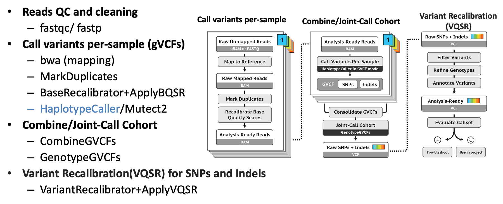

# Germline WGS Pipeline (GATK4 / hg38)

GATK4 best-practice pipelines for germline short variant discovery from whole-genome sequencing data, aligned to the hg38 reference genome. Includes three workflows: VQSR filtering, hard filtering, and de novo variant discovery with genotype refinement.

---

## Required Tools

| Tool | Version |
|---|---|
| Java | 1.8.0_91 |
| Picard | 2.18.0 |
| BWA | 0.7.15 |
| GATK | 4.1.2.0 |
| Samtools | 1.9 |
| R | 3.6.1 |
| fastp / FastQC | — |

---

## Workflow Overview



---

## Reference Bundle (hg38)

The hg38 GATK resource bundle is available from the Broad Institute Google Cloud buckets:

- **Bucket:** `gs://gcp-public-data--broad-references`
- **Browser:** https://console.cloud.google.com/storage/browser/genomics-public-data/resources/broad/hg38/v0

Useful references:
- [Human genome reference builds (GRCh38/hg38)](https://gatk.broadinstitute.org/hc/en-us/articles/360035890951)
- [Preparing a reference for BWA and GATK](https://gatkforums.broadinstitute.org/gatk/discussion/2798)

Place the downloaded bundle under `/project/references/GATK_bundle/`.

---

## Workflow 1: VQSR Filtering

The standard GATK germline pipeline with Variant Quality Score Recalibration (VQSR). Recommended for cohorts with sufficient sample size.

### Steps

**Step 1 — BAM to clean FASTQ**

Converts raw BAM files to paired-end FASTQ and runs quality trimming with `fastp`. Place all raw BAM files (or symbolic links) in `./raw_bam/` before running.

```bash
perl step1_generate_GATK4.1_bam2fq_qc_qsub_grch38_092019_fastp.pl
qsub step1_run_GATK4.1_bam2cleanfq_fastp_qc_qsub_grch38.sh
```

Clean reads are written to `./cleanfq/`.

**Step 2 — Alignment, BQSR, and per-sample gVCF**

Aligns clean reads to hg38 with BWA, marks duplicates, runs Base Quality Score Recalibration (BQSR), and calls variants per sample with HaplotypeCaller (gVCF mode). Also runs Mutect2 in mitochondrial mode for chrM.

```bash
perl step2_generate_GATK4.1_bwa_batch_qsub_BQSR_cleanfq_grch38.pl
qsub step2_run_bwa_GATK4.1_BQSR_callgvcf4sample_qsub_grch38.sh
```

Per-sample gVCFs are written to `./gatk/`; mitochondrial VCFs to `./mito_data/`.

**Step 3 — Joint genotyping (per chromosome)**

Imports all per-sample gVCFs into GenomicsDB and runs joint genotyping with GenotypeGVCFs, submitted as a PBS array job (one job per chromosome). Requires an `./intervals/` folder with one interval file per chromosome.

```bash
qsub step3_consolildate_all_samples_chrs_grch38.sh
```

Per-chromosome VCFs are written to `./population/`.

**Step 4 — Gather, VQSR, and filter**

Gathers per-chromosome VCFs into a single cohort VCF, then runs two-step VQSR (SNP and indel models separately), and applies filters to produce the final call set.

```bash
qsub step4_gathervcfs_VQSR_filter2final_grch38.sh
```

**Output:** `$prefix.indels_snps.recalibrated.passed.vcf.gz` under `./population/`.

Example VQSR command (SNP mode):

```bash
gatk VariantRecalibrator \
    -R /project/references/GATK_bundle/Homo_sapiens_assembly38.fasta \
    -V /project/population/$prefix.HC.vcf.gz \
    -resource:hapmap,known=false,training=true,truth=true,prior=15.0 \
        /project/references/GATK_bundle/hapmap_3.3.hg38.vcf.gz \
    -resource:omni,known=false,training=true,truth=true,prior=12.0 \
        /project/references/GATK_bundle/1000G_omni2.5.hg38.vcf.gz \
    -resource:1000G,known=false,training=true,truth=false,prior=10.0 \
        /project/references/GATK_bundle/1000G_phase1.snps.high_confidence.hg38.vcf.gz \
    -resource:dbsnp,known=true,training=false,truth=false,prior=2 \
        /project/references/GATK_bundle/Homo_sapiens_assembly38.dbsnp138.vcf.gz \
    -tranche 100.0 -tranche 99.9 -tranche 99.5 -tranche 99.0 -tranche 95.0 -tranche 90.0 \
    --trust-all-polymorphic \
    -an QD -an MQ -an MQRankSum -an ReadPosRankSum -an FS -an SOR -an DP \
    -mode SNP \
    --max-gaussians 6 \
    --rscript-file /project/population/$prefix.HC.snps.plots.R \
    --tranches-file /project/population/$prefix.HC.snps.tranches \
    -O /project/population/$prefix.HC.snps.recal
```

---

## Workflow 2: Hard Filtering

Steps 1–3 are identical to the VQSR workflow. Hard filtering is applied in Step 4 as an alternative to VQSR, suitable for smaller cohorts where VQSR training data is insufficient.

```bash
qsub step4_hardfiltering2final_chr1-22X_grch38.sh
```

Output is written to `./hard_filtering/`.

---

## Workflow 3: De Novo Variant Discovery

Germline variant calling follows the same steps as above. Once a combined VCF is available for a trio (father–mother–offspring), the genotype refinement workflow identifies candidate de novo mutations (Mendelian violations).

### Pedigree file

Prepare a PED-format pedigree file before running. Multiple families can be included in a single run (recommended, as it improves VQSR training). Sample names must match exactly between the pedigree file and the VCF.

PED format reference: https://gatk.broadinstitute.org/hc/en-us/articles/360035531972

### Run refinement

```bash
qsub refinement_denovo_only.sh
```

A helper Perl script is included to re-classify de novo variants based on ACMG criteria (activates PM2 for de novo calls):

```bash
perl scripts/deal_clinvar_re_denovo.pl
```

---

## Workflow 4: Variant Annotation and ACMG/AMP Classification

Downstream annotation and classification of germline variants, including de novo calls from Workflow 3. This workflow integrates functional annotation from ANNOVAR and InterVar with population frequency data from gnomAD and ClinVar, then applies the ACMG/AMP classification framework to prioritize candidate pathogenic variants.

### Annotation

Variant annotations from ANNOVAR are processed to consolidate gene assignments for variants mapping to multiple transcripts, and merged with ClinVar and InterVar outputs into a per-sample annotated table. Each variant is classified as SNP or INDEL and tagged with allele counts across the cohort.

### ACMG/AMP Classification

The classification step implements the full ACMG/AMP evidence framework in R, scoring each variant across pathogenic and benign criteria and combining evidence to produce a final call.

**Pathogenic criteria:**

| Strength | Criteria |
|---|---|
| Very Strong | PVS1: predicted loss-of-function in a gene where LOF is a known disease mechanism |
| Strong | PS1–PS4 |
| Moderate | PM1–PM6 |
| Supporting | PP1–PP5 |

**Benign criteria:**

| Strength | Criteria |
|---|---|
| Stand-alone | BA1: allele frequency > 5% in gnomAD/ExAC/1000 Genomes |
| Strong | BS1–BS4 |
| Supporting | BP1–BP7 |

Pathogenic and benign criteria are counted independently and combined following ACMG rules to assign one of five final classifications: Pathogenic, Likely Pathogenic, VUS, Likely Benign, or Benign.

Example of how pathogenic rules are applied:

```r
# PVS1 + at least one PS criterion → Pathogenic
data[data$pvs.count == 1 & data$ps.count >= 1,
     'acmg.pathogenic.classification'] <- 'pathogenic'

# Two or more PS criteria → Pathogenic
data[data$ps.count >= 2,
     'acmg.pathogenic.classification'] <- 'pathogenic'

# PVS1 + one PM criterion → Likely Pathogenic
data[data$pvs.count == 1 & data$pm.count == 1,
     'acmg.pathogenic.classification'] <- 'likely.pathogenic'

# Three or more PM criteria → Likely Pathogenic
data[data$pm.count >= 3,
     'acmg.pathogenic.classification'] <- 'likely.pathogenic'
```

**Additional features:**
- Population frequency analysis using gnomAD, ExAC, and 1000 Genomes, with race-stratified thresholds (EUR, AFR, EAS, SAS)
- Fisher's exact test for case-control allele frequency comparison
- Family segregation analysis: co-segregation with disease in affected family members activates PP1
- Gene-list aware classification: disease genes and modifier genes are handled separately
- Multi-transcript conflict resolution: where a variant maps to multiple transcripts with conflicting calls, the most clinically significant classification is retained

### Annotation Databases Used

| Database | Purpose |
|---|---|
| ANNOVAR | Functional annotation |
| InterVar | Automated ACMG rule scoring |
| ClinVar | Clinical variant evidence |
| gnomAD / ExAC | Population allele frequencies |
| 1000 Genomes Project | Population allele frequencies |

---

## Datasets

### HGDP (Control Cohort)

Reference control cohort from the Human Genome Diversity Project (HGDP).

| Ancestry | Samples | FASTQ path |
|---|---|---|
| Non-European | 704 samples (see `sample_id_non_Euro.txt`) | `/project/HGDP/non_Euro_samples/` |
| European | 137 samples (see `Euro_samples.txt`) | `/project/HGDP/Euro_samples/rawfq/` |

---

## Tips

- Monitor job status after each submission: `qstat -u yourusername`
- The alignment (Step 2) and joint genotyping (Step 3) are the most time-consuming steps — ensure each finishes successfully before proceeding.
- Intermediate files are not deleted automatically. Clean them up manually after all samples in a run are complete to avoid storage issues.
- Create a `./logs/` folder and move log files there after each step to keep the working directory tidy.
